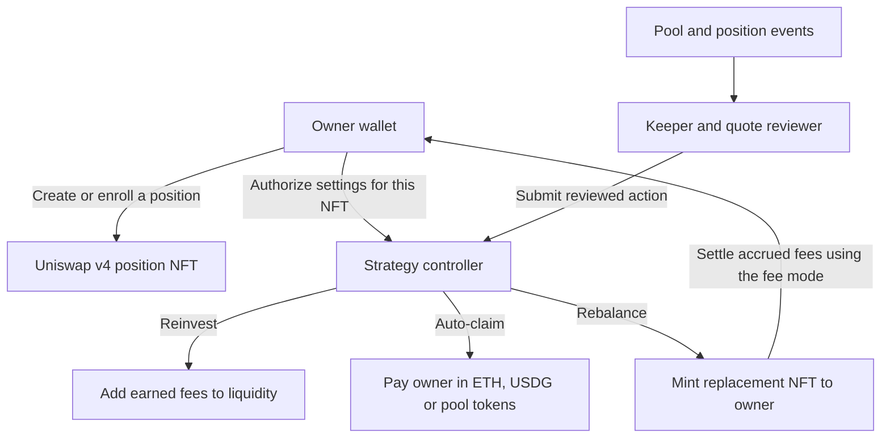

# UserVault

### On-chain P2P trading without price impact on Vault liquidity

**UserVault was created to enable trading without price impact on exchanges settled against Vault inventory. This is the project's core purpose and main advantage.** A larger Vault trade consumes more available liquidity without pushing the traded token's execution price up or down along an AMM curve.

The Vault reads the reference price on-chain from an external liquidity pool, then exchanges assets deposited by users at that price. The traded token is exchanged inside the Vault rather than swapped through the reference pool, so the Vault trade itself does not move that pool's price. Available inventory determines how much can be exchanged; trade size does not set the reference price.

UserVault follows the external market price while separating pricing from settlement. Protocol fees still apply, and the reference price can change with the external market. The no-price-impact property applies to the base-token exchange against Vault inventory. Separate AMM conversion legs can incur price impact.

Economically, this resembles an automated P2P or OTC-style market: users supply the assets, and smart contracts coordinate pricing, matching and settlement. There is no need to find a counterparty manually or negotiate a separate price with each depositor.

[Start app](https://uservault.fun/app) · [Project homepage](https://uservault.fun/) · [Documentation](https://uservault.fun/docs) · [X](https://x.com/User_Vault_)

This description covers the current implementation and published application configuration reviewed on **16 November 2026**. UserVault runs on **Robinhood Mainnet, chain ID 4663**, with ETH used for network gas. Configuration and available features can change as the project develops.

## Liquidity Manager

Liquidity Manager creates and manages concentrated-liquidity positions on Uniswap v4 on Robinhood Chain (4663). Each position is an NFT held by its owner. You can also enable automation on an eligible NFT you already own, including one created through Uniswap.



### Managing a position

1. **Choose a pair and range.** Select two currencies, a pool fee and lower and upper market caps. The app uses the primary market as a price reference. The price in the destination pool and your chosen range determine how much of each token the deposit needs. A position outside the range can require just one token.
2. **Authorize the position.** Confirm the deposit or select Edit automation on an existing position. You choose how this NFT handles fees and whether it rebalances. You can change or disable those settings from the position card. Your wallet signs the settings and any required approvals.
3. **Evaluate and execute.** The Keeper watches relevant pool and position events. The primary pool selection is cached for an hour. When the strategy conditions are met, the Keeper submits a reviewed transaction. The controller checks the position, authorization, deadline and execution limits before the funding, range or payout module settles the action.
4. **Check the result.** Open Log on the position card to see confirmed deposits, auto-claims, reinvestments and rebalances with their timestamps and USD values. Fees reinvested tracks fees automatically put back into liquidity. Wallet payouts are recorded separately.

### Automation

- **Auto-reinvest.** Once newly accrued fees reach the configured USD threshold, the Keeper can add eligible fees to liquidity. After settlement the next standalone reinvestment waits for new accrual.
- **Auto-claim.** Choose ETH, USDG or Pair. ETH and USDG convert the collected fees into the selected currency. Pair sends each accrued pool currency to your wallet. Auto-claim and auto-reinvest are mutually exclusive. The minimum threshold offered by the app is $10.
- **Auto-rebalance.** Enable this independently of the fee mode. When the reference price leaves the range, the Keeper can replace the NFT with one at the new bounds in the same pool. Rebalance now lets the owner request this while still in range. The replacement NFT belongs to the same wallet.

### Liquidity Manager fees

| Action | Protocol fee | Basis |
| --- | --- | --- |
| Fresh wallet capital | 0% | Applies to the new wallet funds used to create or add liquidity. |
| Manual claim in pool tokens | 0% | The owner receives the collected tokens and pays network gas for the wallet transaction. |
| Standalone reinvestment | 1% | Calculated per token on accrued fees actually put back into liquidity. |
| Standalone auto-claim | 1% | Calculated on the realized payout after conversion, if any, and gas reimbursement. Pair applies the rate separately to each distributed token. |
| Rebalance | 0.1% | Calculated on each currency moved from the old position. With reinvestment enabled, accrued fees move with the liquidity under this rate. |

For example, if a standalone ETH auto-claim realizes 0.0100 ETH after its gas reimbursement, the protocol receives 0.0001 ETH and the owner receives 0.0099 ETH. The USD threshold is evaluated on accrued fees, so the net wallet payout can be below that threshold.

The Pool fee (%) field sets the trading fee of the Uniswap pool. LPs earn a share of pool fees while their liquidity is active. The protocol charges above apply when Liquidity Manager performs the corresponding action. Swaps used for conversion or rebalancing can also incur pool fees and price impact.

The Keeper pays network gas up front. On a successful automated action the position reimburses it in ETH or an eligible token equivalent. The app sets ceilings of 0.0005 ETH per operation and 0.001 ETH across the authorized budget. The gas module bills four fifths of measured gas units at the transaction gas price, subject to those ceilings and the remaining budget. The wallet pays network gas for transactions it submits itself.

[Contract sources and build instructions](liquidity-manager/) · [Liquidity Manager user guide](https://uservault.fun/docs#liquidity-manager)

## Why Vault trades have no AMM price impact

An AMM derives execution prices from its reserves and liquidity curve. Buying more of a token moves through that curve, which can worsen the average execution price as order size increases.

UserVault separates **the source of the price** from **the source of the assets being exchanged**:

1. An external pool supplies a reference price.
2. Users' Vault positions supply the actual base tokens and quote assets.
3. Contracts calculate the exchange using the reference price, available inventory and applicable fees.
4. Settlement updates users' inventory and proceeds. It does not swap the traded base token through the reference pool.

For a fixed reference price `P`, expressed as quote units per base token, the core calculation is linear:

```text
Buy:  base received = net quote used / P
Sell: quote received = net base used × P
```

Token decimals and conservative integer rounding are applied by the contracts. Fees are accounted for separately from the reference exchange rate.

There is no Vault reserve equation that raises the price because a buyer takes more inventory or lowers it because a seller supplies more. **The inventory decreases; the pricing rule does not change with order size.**

### Example

Suppose the reference price is **$0.01 per token**, and eligible SELL positions contain **1,000,000 tokens**. Ignoring fees and rounding for illustration:

| Purchase | Tokens received | Reference price |
|---|---:|---:|
| $100 | 10,000 | $0.01 |
| $5,000 | 500,000 | $0.01 |
| $10,000 | 1,000,000 | $0.01 |

The larger trade does not push the Vault execution price up. A $15,000 request cannot obtain 1,500,000 tokens from that inventory: only $10,000 of eligible tokens exists. Depending on the requested minimum fill/output, execution can partially fill and return unused input, or revert. Scarcity limits the fill instead of creating a worse Vault price.

### What this property does and does not cover

- **Reference-price movement:** another trade in the external market can change the reference price before a Vault transaction executes. The browser preview is not a permanent price lock.
- **Fees and gas:** zero AMM price impact does not mean zero transaction cost. Protocol fees, network gas and any conversion costs affect the net result.
- **Available liquidity:** a valid price does not create missing counterparties. Current, Limit and Range inventory must be available and eligible.
- **ETH/USDG conversion:** cross-quote Vault routes can use an AMM adapter to convert ETH and USDG. The base-token match still uses the reference price, but this separate quote-asset conversion can incur AMM fees and price impact.
- **External AMM legs:** an external fill may combine Vault liquidity with Uniswap liquidity. The Vault portion retains reference-priced execution; the AMM portion has the economics of its external route.

Thus, the precise claim is **no trade-size-induced AMM price impact on the base-token exchange executed against Vault inventory**. It is not a promise that every transaction involving UserVault has identical gross and net values, or that every external route is impact-free. [Uniswap's explanation of price impact and slippage](https://support.uniswap.org/hc/en-us/articles/8643794102669-Price-Impact-vs-Price-Slippage) describes the distinction between a trade moving a price and execution differing from a prior quote.

## How users provide liquidity

A Vault market pairs a supported **base token** with a **quote asset**, currently ETH or USDG.

- A **BUY position** deposits quote assets to acquire the base token.
- A **SELL position** deposits base tokens to receive the quote asset.

Users provide one side of the exchange. They do not have to deposit both assets as an AMM liquidity pair. The contracts record ownership, remaining principal, executed amounts and proceeds owed to each position.

Available liquidity is shared across eligible positions. Execution allocates fills proportionally within the selected eligible group, with integer-rounding rules; it is not a first-in, first-out order book. Current-position accounting groups compatible deposits and preserves each owner's entitlement. Limit and Range positions keep their own order and bucket accounting.

### Position types

| Type | When its remaining principal can participate |
|---|---|
| **Current** | At the current validated reference price, whenever matching liquidity and a valid execution are available |
| **Limit / Single** | SELL at or above the specified level; BUY at or below it |
| **Range** | Principal is divided across evenly spaced price levels; each bucket becomes eligible according to the same BUY/SELL rule |

The current application creates Range positions with **16 levels**. The contract supports a broader step range, but that should not be confused with the current UI setting. Limit and Range levels are expressed in USD in the current application.

A limit is an **eligibility condition**, not a separate pricing curve or a guarantee of immediate execution. An eligible bucket exchanges at the validated reference price. Merely crossing a level does not consume its principal: an actual matching transaction must occur. Spent or withdrawn bucket principal cannot be reused.

Current-position admission presently uses a **$20 minimum for opening residual inventory** and a **$100,000 aggregate base-token inventory capacity check across ETH and USDG quote markets**. These are admission checks, not guaranteed liquidity or separate $100,000 BUY and SELL allowances. Limit/Range creation follows its own contract rules. The transaction preview and contract validation determine whether a particular request is admissible.

## From a deposit to a completed exchange

```text
External price source --> Validated reference price
                                      |
BUY / SELL deposits ------------> Vault settlement <--- Direct / external orders
                                      |
                       Proceeds credited or output delivered
                                      |
                 Unfilled inventory remains / unused input is returned
```

There are several ways to consume the same eligible liquidity:

**Creating a position.** Creation can match eligible opposite inventory immediately. For Current creation, admissible residual input can become a position; a remainder that is not retained is returned according to the creation path. Matched proceeds are credited to the creator's position rather than silently being treated as a new liquidity deposit.

**Direct trading.** A user can buy or sell against existing eligible inventory without leaving a standing position. The request specifies a maximum input, minimum fill/output and deadline. A partial fill consumes only the required input and returns the unused portion when the request permits it.

**Internal execution.** The keeper identifies opportunities between deposited positions and submits settlement transactions. Contracts validate eligibility, inventory, reference prices and accounting. Off-chain workers coordinate execution; they do not replace on-chain settlement checks. A keeper outage can delay matching even when users' positions remain recorded on-chain.

**External order filling.** A UniswapX-compatible filler and atomic executor are implemented, alongside the internal keeper. The executor can combine internal Vault legs, supported Uniswap V2/V3/V4 routes and ETH/WETH wrapping. The signed order's required outputs must be delivered for the transaction to succeed. Order availability, route validity, funding and execution economics determine whether an order is filled; integration does not guarantee continuous volume.

## Where the reference price comes from

UserVault obtains its reference price from **on-chain liquidity pools**. The system analyzes available pools, selects a price source and reads the price from that pool's current state on the blockchain.

The Vault uses this reference price to calculate exchanges between users. Its own deposited balances do not determine the price; the reference price follows the external market.

## Fees, proceeds and cashback

Vault and Limit charge a standard execution fee of **30 basis points (0.30%)** on the input actually traded. From the 27 November 2026 upgrade, this rate also covers trades that convert part or all of their input or proceeds between ETH and USDG.

| Operation | Fee treatment |
|---|---|
| Deposit / opening principal | No separate deposit fee; any exchange performed during creation follows the matching rules |
| Withdraw unspent principal | No protocol withdrawal fee |
| Direct Vault or Limit exchange | 0.30% on the filled input. Any refunded input is excluded. |
| ETH ↔ USDG conversion within an exchange | The Vault conversion surcharge is zero. The underlying AMM can still charge its own fee and move the execution price. |
| Passive position proceeds | Standard claim fee on gross proceeds that have not already had the corresponding claim fee paid |
| Creator/internal position matching | No separate matching fee; each side's proceeds retain their applicable claim-fee treatment |

The active trader's execution fee and a passive position owner's claim fee are distinct accounting events. Internal matching must not be described as an extra fee-free claim. Contract accounting tracks already-paid portions to avoid charging the same claim entitlement twice.

**Claim** collects proceeds earned by an executed position. **Withdraw** returns its remaining, unspent deposit. A partially filled position can have both, and withdrawing its remainder does not erase previously earned proceeds. Closed positions can still have unclaimed proceeds. Gas is paid for the transactions themselves.

Protocol fees are recorded separately from user principal, attributed to their economic payer and processed into ETH. Processing and distribution can occur after the original trade. Eligible converted fees allocate **15% of the fee amount as cashback**, not 15% of the trade amount. Cashback becomes claimable after the corresponding fee funding and attribution are completed; it is not an automatic rebate at swap confirmation. External-order cashback has a separate attribution and claim path.

The remaining fee proceeds are allocated under configured treasury/module rules, including Burn reserves and operational gas funding. These rules are configurable and are not the old fixed “70% project / 30% burn” description. They do not authorize treating unspent user deposits as protocol revenue.

## What each application section is for

| Section | Purpose |
|---|---|
| **UserVault** | Browse available Vault liquidity, choose a side, create positions and trade against eligible inventory |
| **Positions** | Review owned Current, Limit and Range positions, remaining amounts, claimable proceeds and exits |
| **Liquidity Manager** | Create Uniswap v4 liquidity positions and manage their automation |
| **Burn** | Reserved interface for USER burn-and-claim functionality when a valid deployment is connected |
| **Wallet / cashback controls** | Inspect supported fee entitlements and submit claims |

**Burn is not currently enabled as a public burn-and-claim feature in the published network configuration.** The USER token and burn-and-claim addresses are unset there. Fee infrastructure can reserve Burn funding without making USER redemption available. Earlier token-supply, bonus, cooldown and redemption examples should not be read as current user entitlements or a launch commitment.

## Getting started

1. Open [uservault.fun](https://uservault.fun/) and select **Start app**.
2. Connect a compatible wallet on Robinhood Mainnet and retain ETH for gas.
3. Use **UserVault** for reference-priced trading or to create a BUY/SELL position. Choose Current, Limit or Range according to when you want the position to participate.
4. Check the asset addresses, quote asset, amount, price conditions and transaction preview. An ERC-20 approval authorizes spending; it is separate from creating or executing the position.
5. Confirm the intended transaction in the wallet. A submitted transaction and a completed exchange are different states.
6. Use **Positions** to claim executed proceeds or withdraw unspent principal.

The application header menu links back to the start page and documentation. Prices and position views use event-driven services and caches. A stale or unavailable UI view does not itself prove that funds were lost or a position was filled; the transaction receipt and contract state determine execution.

## Architecture and trust boundaries

The implementation separates Vault custody/accounting, Limit/Range management, source pricing, liquidity snapshots, execution coordination, fee processing and external-order settlement into modules. The website and background services provide discovery, previews, synchronization and transaction preparation.

Funds deposited into positions are held by smart contracts and accounted to their owners. Users sign transactions from their wallets; keeping control of a wallet is not the same as keeping deposited assets outside contract risk.

The deployed modular architecture uses **upgradeable beacon proxies** with administrative authority over upgrades. Other controls include supported configuration changes and pause functions. Consequently, the protocol should not be described as immutable or independent of administrative trust. Source signing and worker availability are additional dependencies.

On-chain checks cover such matters as input/output limits, deadlines, permitted routes, token and contract identities, available inventory and settlement balances. They reduce specific failure modes; they do not establish that the system is free of bugs, economic attacks or external dependencies. This README is an implementation description, not an independent security audit.

## License

**UserVault — Proprietary License. Copyright © 2026 [UserVault]. All Rights Reserved.**

UserVault-authored source code, contracts, API, architecture and documentation are provided under [LICENSE](LICENSE). No permission to copy, modify, distribute, sublicense, sell or commercially exploit them is granted without prior written authorization. This is not an open-source license.

Third-party dependencies are installed separately and retain their own licenses, as explained in [NOTICE](NOTICE). They are not relicensed as UserVault property.

## Current Vault source package

This repository contains the current Vault contract architecture, its required libraries and interfaces, public ABI files and integration documentation. It includes the aggregate Limit/Range implementation activated on 16 November 2026. Production services, website source, operator tools and standalone external-order execution are outside this package.

[Contract map and build instructions](CONTRACTS.md) · [Deployment manifest](DEPLOYMENT.json) · [Source manifest](SOURCE-MANIFEST.json) · [Build verification](BUILD-VERIFICATION.json)

The public [Vault liquidity API](https://uservault.fun/api/v1/fillers) supports independent integrations without an API key. Integrators provide their own funding and sign their own transactions. The API prepares unsigned transactions; it does not hold signing keys or reserve liquidity. See the [integration guide](api/README.md).

The HTTP API covers same-quote direct Current Vault trades. Current Limit/Range and cross-quote ABIs are supplied for integrations that implement their own transaction construction and simulation. They are separate from the HTTP quote endpoint.

## Aggregate Limit/Range accounting

Eligible Range inventory is indexed by price level and market. A group fill updates aggregate inventory and proceeds in one atomic transaction without visiting each participating position. Per-position shares determine each owner's entitlement; reads, claims and withdrawals settle those entitlements lazily.

The aggregate manager uses AggregateRangeAccounting and RangeInternalExecution. MainnetMarketLiquiditySnapshot exposes aggregate liquidity to creation and execution modules. Current Vault custody remains in its existing module. Standard fee rules and proportional ownership are preserved. Integer rounding is performed through aggregate share accounting rather than the former independent rounding of every Range part; differences can occur in the smallest token units.

This removes an execution loop proportional to all participating Range positions. It does not remove block gas limits or the existing per-position maximum of 128 price levels. Withdrawals and claims remain owner-specific operations. Unfilled principal and earned proceeds are separate balances.

## Deployment reference

The following addresses are listed in the published application configuration for chain **4663** at the review date:

| Component | Address |
|---|---|
| Shared Vault | `0x706c8a48a6c1230a18be9eff2c961dc5b9e3ffaa` |
| Pricing | `0xcf4da6edf1e21a252764491f7ac8e583bb1db23b` |
| Limit/Range manager | `0x599dd12ecf935f9e1d36ce713dfa6290436a63d8` |
| USDG | `0x5fc5360d0400a0fd4f2af552add042d716f1d168` |
| Wrapped ETH | `0x0bd7d308f8e1639fab988df18a8011f41eacad73` |

These are identification references, not instructions to transfer assets directly to a contract. Use the supported application flow and check the active network and transaction. The [published network configuration](https://uservault.fun/network-config.js) identifies current application bindings; addresses and implementation code can evolve.

## Disclaimer

UserVault and its documentation are provided for informational and technical purposes. They are not financial, investment, legal or tax advice, and do not recommend buying, selling or holding any asset. “P2P” and “OTC-style” describe the trading mechanism, not a legal or regulatory classification.

Use is at your own risk. Smart-contract defects, administrative changes, token behavior, manipulated or unavailable price sources, insufficient liquidity, external integrations and network failures can cause delays or loss, including loss of all deposited assets. No execution time, return, price advantage, cashback funding or future token redemption is guaranteed. To the extent permitted by applicable law, the project and its contributors disclaim liability for losses arising from use of the software or reliance on this documentation.
